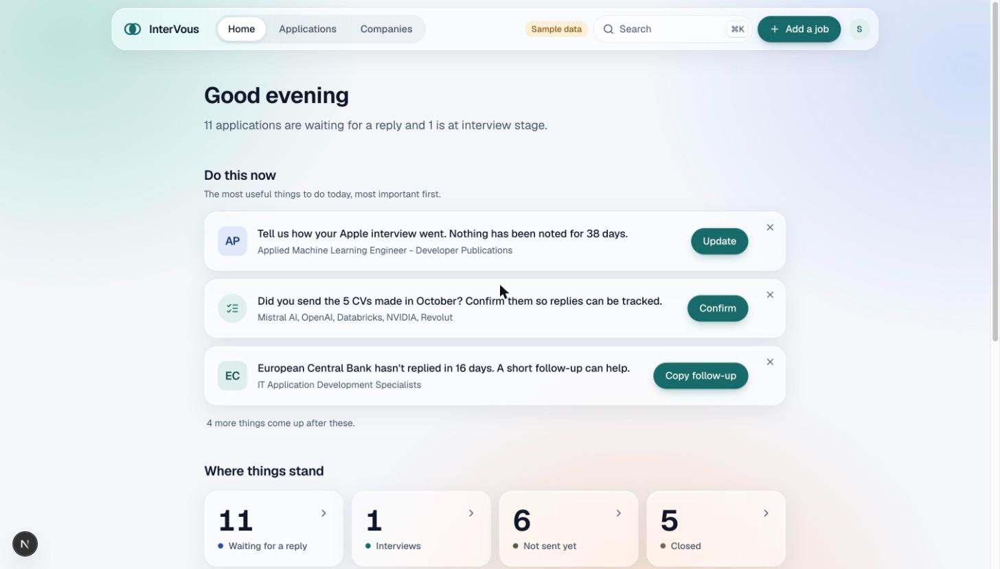
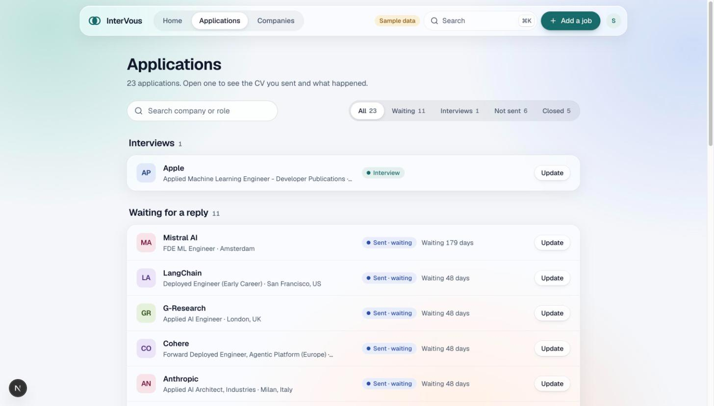
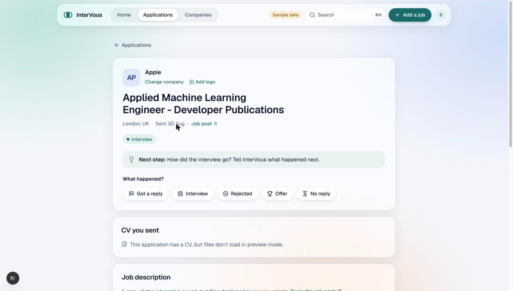
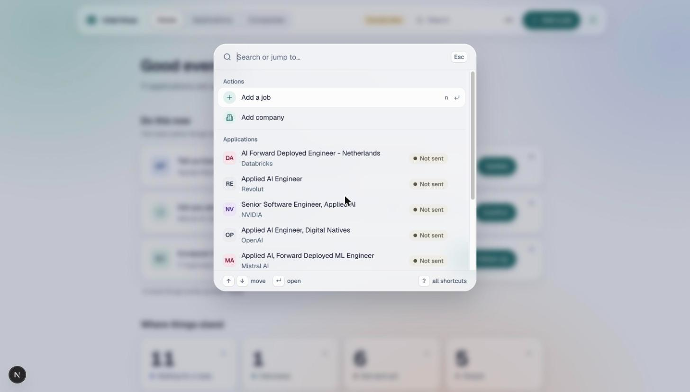
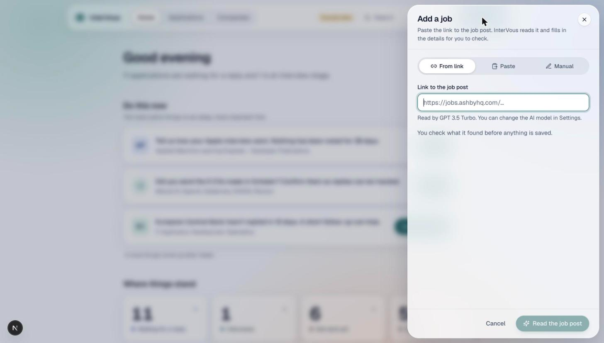
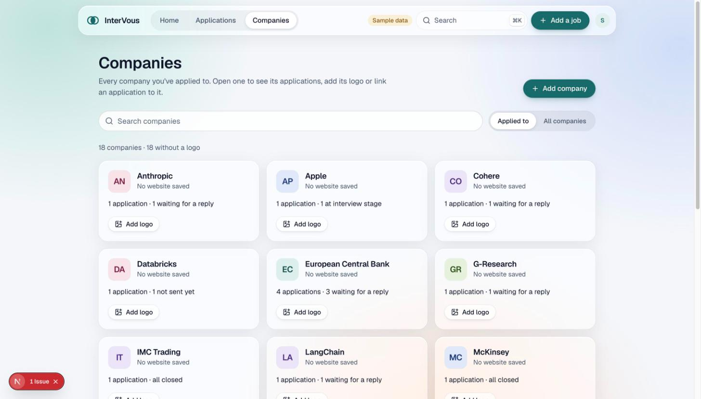
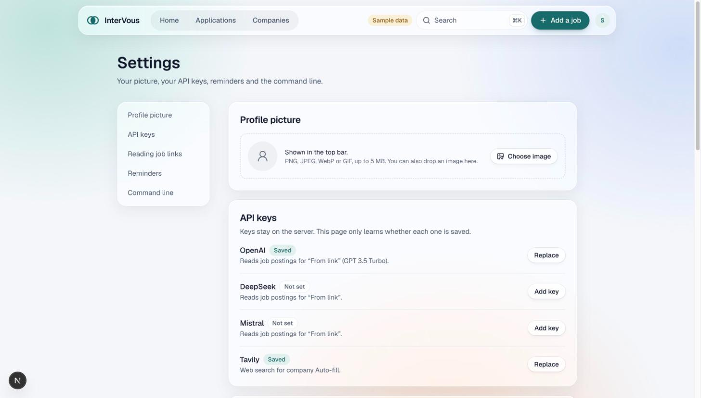
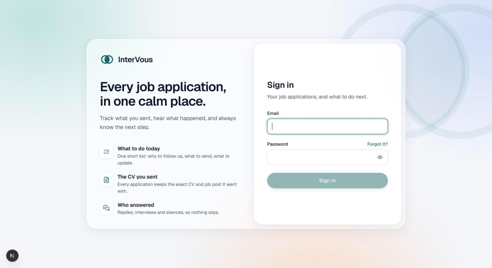

<div align="center">


# InterVous

### Every job application, in one calm place.

Track what you sent · hear what happened · **always know the next step.**

<br/>


[**Live app →**](https://albertobarnabo.com/intervous)

</div>

<br/>

<p align="center">
  
</p>

<br/>

A job search is dozens of applications, each with its own CV, its own thread, and its own silence. Spreadsheets tell you _what you have_. **InterVous tells you what to do next** — one short list, in plain language, ranked by what actually matters today. Behind the calm surface is a deterministic rules engine, honest statistics that refuse to lie about small samples, and a design system that is linted for contrast on every build.

> It's a personal product, open‑sourced as a showcase of how it's built. The hosted instance is single‑account (sign‑up is intentionally off), but everything here runs locally — including a **fixture mode** that renders every screen from sample data, no login or database required.

---

## ✨ Why it's different

- **🎯 A "do this now" list, not a dashboard.** The Home screen reads your whole pipeline and surfaces the few things worth doing — _"Tell us how your Apple interview went"_, _"European Central Bank hasn't replied in 16 days — a short follow‑up can help"_ — each with a one‑tap action. The ranking is computed by a pure, deterministic engine (`lib/core`), not hard‑coded.
- **📄 The CV you sent, and who answered.** Every application keeps the exact CV and job post it went with, a timeline of replies / interviews / silences, the questions you answered, and the "fit items" the posting asked for. Open one application and the whole story is on one page.
- **📊 Statistics that won't lie to you.** Response‑ and interview‑rates run through [Wilson confidence intervals](https://en.wikipedia.org/wiki/Binomial_proportion_confidence_interval#Wilson_score_interval) with real sample‑size floors: no percentage below _n=20_, no group comparison without _n≥10_ and non‑overlapping intervals, no median under 5 values. Small numbers are shown as counts, never as misleading rates.
- **⌨️ Keyboard‑first, ⌘K everywhere.** A command palette jumps to any application, company or action and runs inline mini‑forms ("mark as sent", "log a reply") without leaving it. Vim‑style chords (`g h`, `g a`, `g c`, `n`, `/`, `?`) move you around without touching the mouse.
- **🤖 Add a job from a link — with your own AI keys.** Paste a posting URL and InterVous scrapes it (behind a hardened SSRF guard) and extracts the company, role and location with the model _you_ choose — OpenAI, DeepSeek or Mistral. You review what it found before anything is saved.
- **🏢 Company research & automatic logos.** With a Tavily key, one tap enriches a company (description, industry, HQ, founded, employees) and finds its website and logo by scraping favicons / apple‑touch‑icons with a Google fallback. Nothing is stored until you confirm it.
- **🔐 Your keys never touch the browser.** API keys live only in the database (row‑level‑secured) and are read **server‑side**, authenticated by your Supabase access token. The client only ever learns _whether_ a key is saved — never its value.
- **🎨 Calm by design, accessible by gate.** An Apple‑style glass UI over a soft teal backdrop, light‑mode only on purpose, with a contrast checker wired into `npm run lint` that **fails the build** on any text/background pair below 4.5:1.
- **🖥️ One brain, two front‑ends.** The same zero‑dependency core engine powers the web app _and_ a Node CLI (`intervous`), so the terminal and the browser always agree on your pipeline.

---

## 📸 A look around

<table>
  <tr>
    <td width="50%"><p align="center"><b>Applications</b> — grouped by where they stand</p></td>
    <td width="50%"><p align="center"><b>The dossier</b> — one application, one page</p></td>
  </tr>
  <tr>
    <td width="50%"><p align="center"><b>⌘K palette</b> — jump or act, no mouse</p></td>
    <td width="50%"><p align="center"><b>Add a job</b> — from a link, paste, or by hand</p></td>
  </tr>
  <tr>
    <td width="50%"><p align="center"><b>Companies</b> — logos, links & research</p></td>
    <td width="50%"><p align="center"><b>Settings</b> — keys stay on the server</p></td>
  </tr>
  <tr>
    <td colspan="2"><p align="center"><b>Sign in</b> — your applications, and what to do next</p></td>
  </tr>
</table>

---

## 🧠 How it works

InterVous is **client‑first**: every screen is a React 19 client component reading and writing Supabase directly under Row‑Level Security. Server code is deliberately thin — just three Route Handlers for the things a browser shouldn't do (reach the open web, hold secrets).

```
┌─────────────────────────── Browser (Next.js App Router) ───────────────────────────┐
│  (app)/ pages ── AppShell + ⌘K palette ── lib/data (client)  ──►  Supabase          │
│        home · applications · applications/[ref] · companies · settings              │
│                                   │                                                  │
│                      lib/core  (pure, deterministic engine)                          │
│          today queue · insights · phase rules · honest stats · status lines          │
└───────────────────────────────────┬──────────────────────────────────────────────┘
                                     │  Bearer <access_token>
                   ┌─────────────────▼─────────────────┐        ┌──────────────────────┐
                   │  /api route handlers (Node)        │        │  Supabase             │
                   │  • scrape-job   (SSRF‑guarded)     │◄──────►│  Postgres + RLS       │
                   │  • company-research (Tavily)       │  keys  │  Auth · Storage       │
                   │  • keys-status  (booleans only)    │        │  Realtime             │
                   └────────────────────────────────────┘        └──────────────────────┘
```

**`lib/core` — the single source of truth.** A self‑contained, zero‑dependency ES‑module engine (`intervous-core`), imported by both the web UI and the CLI. It's entirely deterministic and side‑effect‑free:

| Module | Responsibility |
| --- | --- |
| `dates` | Timezone‑safe `YYYY‑MM‑DD` day arithmetic |
| `phases` | The one copy of phase / label / board‑column maps, mirroring the SQL functions |
| `slug` | `slugify` / `resolveRef` / `normalizeUrl` / `escapeLike` |
| `stats` | The sample‑size rules — Wilson intervals, no rates below _n=20_ |
| `derive` | Per‑application facts computed once and shared |
| `today` | The 10‑item prioritised "do this now" queue |
| `insights` | I1–I10 analytics, every rate routed through `stats` |
| `home` | The plain‑language summary, action cards and status tiles |

Because the rules live in one tested place, the web app, the CLI and the Postgres triggers can never drift.

---

## 🔐 Security model

- **Keys are server‑only.** Per‑user provider keys live in the RLS‑protected `keys` table — never in env vars, never sent from the browser into an API call. Each protected route calls `serverKeys.getUserAndKeys()`, which reads your `Authorization: Bearer` token, builds a Supabase client that runs as _you_, authenticates, and reads your own key row. Keys are used and discarded; `keys-status` returns only `{ open_ai, deep_seek, mistral, tavily }` booleans.
- **Row‑Level Security everywhere.** Every table is own‑rows by `auth.uid()`; the `job_overview` read model is a `security_invoker` view so RLS still applies through it.
- **A real SSRF guard.** The job scraper only fetches user‑supplied URLs through `safeFetch` — http/https and ports 80/443 only, DNS‑resolved and blocked against private / loopback / link‑local / metadata ranges, connection pinned to the vetted address, ≤3 re‑checked redirects, and 2 MB / 10 s caps.
- **Private documents.** CV files live in a private Supabase bucket served only through 10‑minute signed URLs; avatars and logos are public‑read but writes are locked to the owner's folder. Raster‑only logo uploads (no script‑carrying SVGs).
- **No leaky errors.** Provider error text is never forwarded verbatim — it could echo a key.

---

## 🛠️ Tech stack

| Area | Choice |
| --- | --- |
| **Framework** | Next.js `15.5` (App Router, Turbopack dev) · React `19` · TypeScript `5` |
| **Styling** | Tailwind CSS `v4` (CSS‑first, no config file) · Apple‑style glass · Geist · `motion` |
| **UI primitives** | Headless UI · lucide‑react · `@dnd-kit` (drag‑and‑drop board) · a hand‑rolled `src/ui` catalogue |
| **Backend** | Supabase — Postgres + Auth + Storage + Realtime, Row‑Level Security |
| **AI (bring your own key)** | OpenAI `gpt-3.5-turbo` · DeepSeek `deepseek-chat` · Mistral `mistral-medium-latest` |
| **Web research** | Tavily (company enrichment + logo discovery) |
| **Scraping** | `cheerio` + `turndown`, native `fetch` behind an SSRF guard |
| **Docs / PDF** | `pdfjs-dist` (CV viewer) · `react-markdown` + `remark-gfm` |
| **Testing** | Node's built‑in `node:test` · a dockerised SQL migration harness · a contrast linter |

> ℹ️ The old README mentioned DaisyUI, Flowbite and Axios — those aren't used. The styling is Tailwind v4 + Headless UI + lucide, and HTTP is native `fetch` + cheerio/turndown.

---

## 🚀 Getting started

**Prerequisites:** Node.js 20+ and npm.

```bash
git clone https://github.com/albertobarnabo/InterVous.git
cd InterVous
npm install
```

### Run it with sample data (no login, no database)

The fastest way to explore every screen — this is exactly how the screenshots above were made:

```bash
NEXT_PUBLIC_FIXTURES=1 npm run dev
```

Then open **<http://localhost:3000/intervous>** (note the `/intervous` base path; `/` redirects to `/home`). A **"Sample data"** badge confirms fixture mode. Writes mutate an in‑memory copy and reset on reload. Drop your own fixture at `lib/core/test/fixture.json` (git‑ignored) or a built‑in placeholder is served.

### Run it for real (your own Supabase)

1. The committed `.env` already contains a **public** `NEXT_PUBLIC_SUPABASE_URL` and `NEXT_PUBLIC_SUPABASE_ANON_KEY` (anon keys are safe to expose; RLS does the enforcing). Point them at your own project to use your own data.
2. Provision the schema in the Supabase SQL editor by running the migrations in `supabase/migrations/` in order (start with `…_intervous_v2.sql`).
3. Start the dev server and sign in with a Supabase Auth user:
   ```bash
   npm run dev
   ```
4. In **Settings → API keys**, add any provider keys you want (OpenAI / DeepSeek / Mistral for job‑link reading, Tavily for company research). They're stored in your `keys` table, not in env.

### Scripts

| Command | What it does |
| --- | --- |
| `npm run dev` | Dev server (Turbopack) at `/intervous` |
| `npm run build` / `npm start` | Production build & serve |
| `npm run lint` | **Contrast gate** (`scripts/contrast.mjs`) + `next lint` |
| `npm test` | Core + backend unit tests (`node:test`) |
| `npm run test:cli` | CLI test suite |
| `npm run check:contrast` | Just the accessibility contrast check |

---

## 🧪 Testing & quality

- **Unit tests** run on Node's built‑in runner (no Jest/Vitest): `lib/core/**` (dates, slug, phases, stats, today, insights, home) and `lib/backend/**` (the SSRF guard).
- **Contrast is CI‑grade.** `scripts/contrast.mjs` parses the design tokens and fails `npm run lint` if any text/background pair — _including text on glass over the brightest part of the backdrop_ — drops below WCAG AA (4.5:1).
- **The SQL migration is tested against real Postgres.** `scripts/test-sql.sh` spins up a throwaway `supabase/postgres` container, applies the migration **twice** (idempotency) and runs the test suite across 8 schema variants (base, int8, date, timestamptz, strict, noowner, upgrade, rollback) — never touching the live project.

---

## 🎨 Design system

Tailwind **v4**, configured entirely in CSS (`globals.css`, no `tailwind.config.js`). Design tokens are plain `--name: #hex` declarations mapped to utilities via `@theme inline`. The signature material is **glass** — `.iv-glass` / `.iv-glass-thick` / `.iv-glass-solid` — floated over a fixed, soft three‑colour radial backdrop (pale teal, blue, peach) so the frosting has something to refract. It's **light‑mode only, on purpose** (dark mode is deliberately disabled), accent teal `#1A6B6B`, type set in Geist. Glass gracefully degrades to opaque white under reduced‑transparency, high‑contrast and print. Every interactive element gets `cursor: pointer`, a visible focus ring, and a reduced‑motion fallback.

---

## 📁 Project structure

```
InterVous/
├── src/
│   ├── app/
│   │   ├── (app)/            # authenticated pages behind one guard + AppShell
│   │   │   ├── home/         #   the "do this now" dashboard
│   │   │   ├── applications/ #   list + [ref] dossier
│   │   │   ├── companies/    #   directory, panel, research, logos
│   │   │   └── settings/     #   avatar · API keys · reminders · CLI
│   │   ├── api/              # scrape-job · company-research · keys-status
│   │   ├── login/ · reset-password/   # public auth pages
│   │   └── dev/fixture/      # dev-only sample-data route
│   ├── components/           # AppShell, modals
│   ├── features/             # command palette, new-application sheet, …
│   └── ui/                   # the primitive catalogue (Button, GlassCard, …)
├── lib/
│   ├── core/                 # ⭐ zero-dep deterministic engine (+ node:test suites)
│   ├── data/                 # client-first data layer (+ fixture store)
│   └── backend/              # server-only: keys, scrapers, LLM adapters
├── supabase/migrations/      # the Postgres schema (RLS, triggers, views)
├── cli/                      # the `intervous` command-line companion
├── scripts/                  # contrast.mjs · test-sql.sh
└── docs/                     # this README's assets + SPEC.md
```

---

## 🖥️ Command‑line companion

InterVous ships with a Node CLI (`cli/`). Run `intervous login` once in a terminal and it works against the same core engine and database as the web app — `intervous open` even prints the dossier URL for an application. The **Settings → Command line** panel shows your most recent CLI‑sourced events, each linking back to its application.

---

<div align="center">

Built by [**Alberto Barnabò**](https://albertobarnabo.com) · [albertobarnabo.com/intervous](https://albertobarnabo.com/intervous)

<sub>The hosted app is single‑account. Curious and want a look? <a href="mailto:alberto.barnabo@gmail.com">Say hi.</a></sub>

</div>
